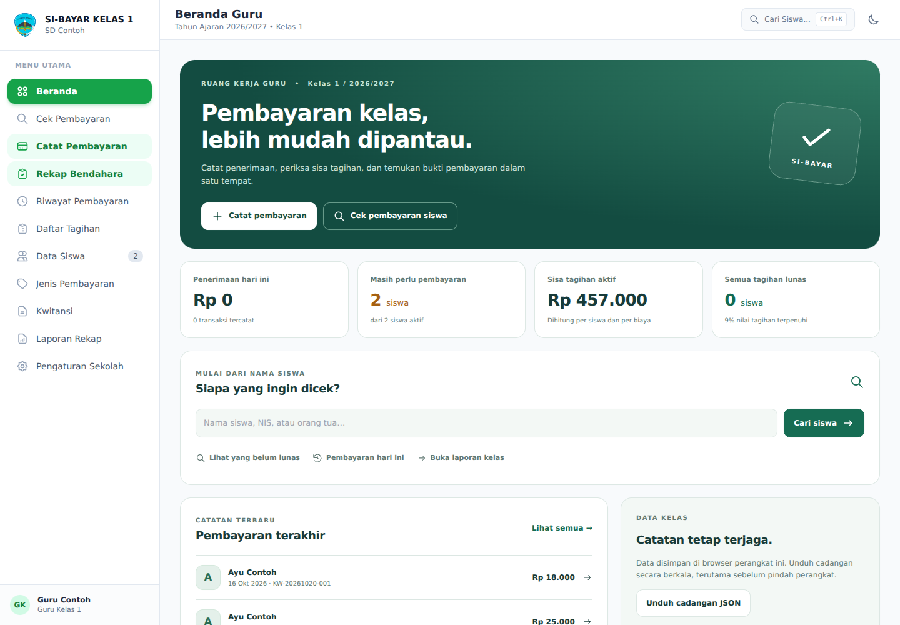
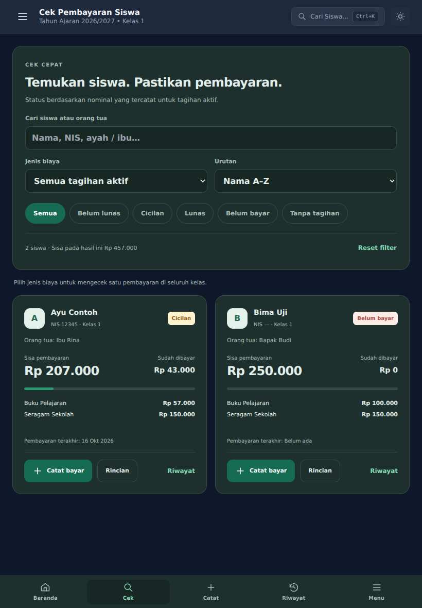

# Validasi ruang kerja guru

Basis perubahan: commit `39fe98fc29284c3592546d2adf9bb333e8013273`.

## Temuan dan perbaikan

| Temuan pada kode awal | Perubahan |
| --- | --- |
| Daftar siswa tanpa isian `father` diganti dengan data default saat reload | Pertahankan siswa/ID/data yang tersimpan, termasuk kelas kosong |
| Kelebihan bayar satu biaya mengurangi tunggakan biaya lain | Jumlahkan sisa setiap biaya dan setiap siswa |
| Nomor kuitansi berdasarkan jumlah transaksi, berulang setelah penghapusan | Urutan tertinggi dan penanda urutan tersimpan |
| Tanggal pembayaran terakhir mengikuti urutan iterasi | Ambil tanggal transaksi paling baru |
| Handler HTML merujuk `Store` yang tidak tersedia secara global | Hubungkan handler ke store yang sama |
| Riwayat/data siswa kosong setelah tema/modal menggambar ulang halaman | Isi kembali daftar pada setiap render |
| Koreksi nominal menghilangkan fokus dan input formulir | Perbarui total/kembalian tanpa mengganti DOM formulir |
| Penyimpanan koreksi/penghapusan dapat gagal tetapi UI menganggap berhasil | Validasi dan rollback data/audit saat gagal |
| Cicilan ke dua penerima digabung memakai status seluruh jenis biaya | Hitung penerima per rincian transaksi |
| Tata letak bergantung pada Tailwind CDN | CSS lokal dengan build yang dapat diulang |

## Pemeriksaan yang selesai

- `npm test`: 20 pengujian regresi lulus (termasuk pemeriksaan sintaks skrip).
- `npm run build:css`: stylesheet berhasil dikompilasi.
- Browser Chromium headless: pencarian melalui nama ibu, filter biaya, cicilan, uang kembalian, catatan dan tanggal transaksi, penyimpanan/reload, koreksi nominal dan alasan, filter rentang tanggal, CSV hasil filter, backup JSON, ganti tema, serta navigasi bawah.
- Layout pada 360×800, 390×844, 820×1180, dan 1440×1000. Tidak ada overflow halaman pada menu utama yang diperiksa. Beranda, cek pembayaran, dan riwayat tidak membutuhkan gulir horizontal pada ukuran tersebut.
- Tidak ada kesalahan JavaScript pada alur browser yang diuji. Pengujian memakai data contoh lokal; tidak mengubah data operasional perangkat pengguna atau snapshot cloud.
- `git diff --check` tidak menemukan kesalahan whitespace.

## Batas pemeriksaan

- Bukan pengujian pada HP/tablet fisik atau printer fisik.
- Layanan eksternal diblokir dalam pengujian browser untuk memastikan fungsi inti dan CSS lokal tetap berjalan. XLSX, ekspor gambar, autentikasi/sinkronisasi Supabase belum diuji secara langsung dengan layanan aktif.
- Tagihan berulang belum dibuat per periode. Tidak ada penambahan backend atau perubahan SQL dalam pembaruan ini.
- Penyimpanan lokal tidak menyediakan transaksi serentak antar-tab. Gunakan satu tab utama untuk pencatatan.
- Revisi foto rapor ditujukan untuk penggabungan PR #1 ke `main` setelah pemeriksaan otomatis berhasil. Status publikasi diperiksa melalui workflow GitHub Pages.

## Contoh tampilan dengan data uji

## Revisi foto rapor

Tambahan Rp30.000 untuk putra/putri (satu kali). Empat pengujian tambahan mencakup data baru, migrasi data lama/reload/penghapusan yang disengaja, pencegahan duplikat serta pemeliharaan tarif/status yang sudah diubah, dan alur cicilan hingga lunas untuk tagihan foto rapor.

## Buku kas terpisah & Dropbox — 21 Oktober 2026

- 26 pengujian Node lulus: regresi pembayaran sebelumnya, pemisahan buku lain-lain, konservasi saldo, transaksi historis/nonaktif, rollback gagal simpan, blokir penghapusan penerimaan yang sudah disetor, validasi backup/ID/tanggal, setoran tidak mendahului penerimaan.
- Uji Chromium desktop 1440×1000 dan ponsel 390×844: input setoran, tagihan dan pembayaran lain-lain, reload, menu, overflow halaman, tanpa error JavaScript tak tertangani.
- Dropbox diuji dengan respons API tiruan: upload seluruh buku tanpa token, daftar, unduh, dialog konfirmasi restore, pemulihan, dan sesi 401. OAuth callback: state salah ditolak, state benar menukar kode dengan PKCE tanpa client secret, parameter kode dibersihkan dari URL.
- Koneksi dan izin Dropbox akun nyata belum diverifikasi; memerlukan App key administrator dan persetujuan akun. Ini bukan klaim uji end-to-end Dropbox produksi.
- Screenshot: `setoran-desktop.png`, `lain-lain-mobile.png` menggunakan data uji lokal; data uji tidak disimpan sebagai database bawaan.

Browser smoke test disimpan pada `tests/browser-smoke.cjs`; jalankan dari akar repo dengan modul Playwright tersedia (`PLAYWRIGHT_MODULE` opsional) dan executable Chromium pada `CHROMIUM_PATH` bila bukan instalasi Playwright standar. API eksternal diblokir/dimock selama pengujian; tidak mengubah akun produksi.
